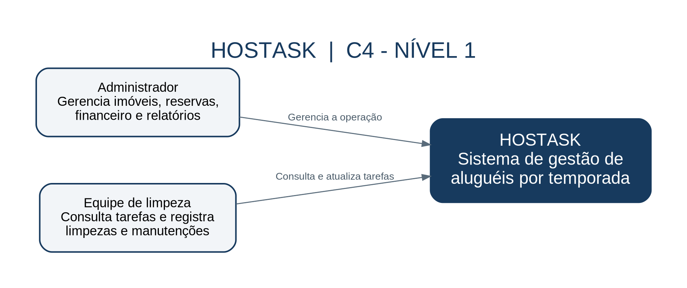
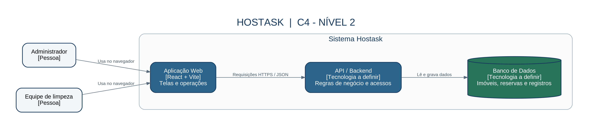

# Arquitetura do Hostask

## Visão geral

O Hostask é um sistema de gestão de aluguéis por temporada. Ele reúne imóveis, reservas, limpezas, manutenção, estoque e financeiro.

A arquitetura é apresentada com dois níveis do modelo C4: Contexto e Contêineres.

## Nível 1 — Diagrama de Contexto

Este diagrama apresenta os usuários e sua relação com o Hostask.

### Administrador

Gerencia os imóveis, as reservas, o financeiro e os relatórios.

### Equipe de limpeza

Consulta tarefas e registra informações de limpezas e manutenções.

### Hostask

Centraliza as informações e as operações de gestão dos aluguéis por temporada.

Não há integração externa confirmada representada neste diagrama.

## Nível 2 — Diagrama de Contêineres

Este diagrama apresenta a divisão técnica proposta para o sistema.

### Aplicação Web

**Tecnologias:** React e Vite.

Responsável pela interface e pela navegação. É acessada pelo administrador e pela equipe de limpeza por meio do navegador.

### API / Backend

**Tecnologia:** a definir.

Responsável por processar as regras de negócio e controlar as permissões de acesso.

A comunicação prevista entre a aplicação web e a API utiliza HTTPS e dados em JSON.

### Banco de Dados

**Tecnologia:** a definir.

Responsável por armazenar imóveis, reservas e os demais registros do sistema.

A API realiza a leitura e a gravação desses dados.

## Fluxo de comunicação

1. O usuário acessa a aplicação web pelo navegador.
2. A aplicação envia uma solicitação à API.
3. A API verifica as permissões e processa as regras.
4. Quando necessário, a API consulta ou atualiza o banco de dados.
5. A resposta retorna para a aplicação e é apresentada ao usuário.

## Situação da arquitetura

A API e o banco de dados representam a arquitetura proposta. Suas tecnologias ainda precisam ser confirmadas.

Os diagramas foram reaproveitados da Atividade 1.